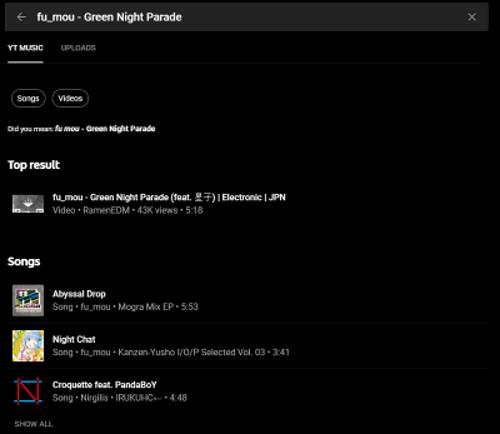

[Go Back](../)

# The perfect music service doesn't exit
Well. At least not for me ¯\\_ (ツ)_/¯

## But why

Well, currently i have been using Google Play Music (Referenced as GMusic from now on) for the last six years, the only reason being why, was that i could upload all my own MP3 files to their servers, and listen to them where i was, on what ever device i wanted to, without any hassle. This have been working amazingly for me for all this time, with any hiccups (except for maybe being able to replace a uploaded song). But it has been lacking in a lot of other departments

### I'm feeling lucky

So, just like all other music streaming services out there, Google has made this feature called "I'm feeling lucky", which makes a "radio" based on songs you have clicked liked on. Sounds like something Google should be able to nail, i mean they know how to do it with Google searches and Youtube videos. Well, it's garbage. Well, for me it's garbage. I have a board taste in music, so i listen to a lot of different genres, in a lot of different languages, which means that over the last six years of i have liked a bunch of songs. This has also resulted in the I'm feeling lucky thing breaking. It will only give me one genre of music, in one language, for that one button press. So if i am feeling like listening to some random music, then i better like these random german pop songs it's giving me, because i have some german songs in my likes, and some pop songs as well. I just wish that i would take my entire list of liked songs, and play me that, with some new stuff sprinkled in at different points.

### No desktop client (well, not a official one)

This is the thing that has been kinda annoying me. Most streaming services have a desktop client that you can use, that integrated well into your OS, so you can use media keys and what not. But GMusic doesn't have one. I have always wondered why, because i hear a ton of people really wanting one. But i guess that they just want people to stay inside of their browser (preferably Chrome properly), and i did this for a long time. I got a plugin for Chrome that allowed me to use Media Keys, and custom keybindings for media keys on keyboards that don't have them, and then i would run GMusic in a Chrome app window, this way GMusic could run without having the Chrome browser open, and not having to find the tab inside the giant list of already existing tabs i have. Later i moved onto a Electron powered unofficial desktop for GMusic called [Google Play Music Desktop Player](https://www.googleplaymusicdesktopplayer.com/). But it is slow and sluggish on even good speced systems, and it seems like the development has slowed down on it. But hey, at least it has a built in dark mode 😎

### It isn't social

This is a weird one, and could best be explained this way. When ever somebody sends you a link to a song, there is a good chance that it will be a Spotify or Youtube video link, because that's what people use. So when you get one of those (if you are luck enough that people will share music with you), then be prepared to find that song on GMusic or Youtube if it is a Spotify link. There is also no easy way as seeing what other people are listen to right now as Spotify have (well, if you have a facebook account). Plus, if you wanted to share a link to a song, then you will have to go onto Youtube, or hell, even the Spotify web play to find that song, to send it to your friends. It's annoying, and i don't think most people care about this, but hey, i do.

### The lack of good playlists

Last year i got a offer from Spotify, that i could try the premium service for three months, for the price of a coffee. It was an offer that i could not decline. I have used Spotify in the past before i started using GMusic, so i was interested in how the service was today, and i was blown away. The playlists they have on Spotify are great, and they even seemed to be [human created](https://www.youtube.com/watch?v=Ji_WfHxatoQ), which is a cool thing, in my option. Some of the playlists also have their own art and descriptions, which it also seems like verified users on Spotify can create leading to some get findings when i was using their service.

## So why are you writing this

Well, GMusic is set to shut down by the end of this year, and in stead of riding it out till it dies, i was thinking of look what else was on the market, to see if the perfect streaming service existed (hint: it still doesn't, but it's close)

### Spotify

Love it or hate it. Spotify is the king when it comes to music streaming. Everybody who knows about music streaming has heard about Spotify, and they might even have used it. Spotify has 286 Million monthly active users as of writing this, and i can see why i just works for all those people. It has a great app, they have a desktop client, and even a web player. They have amazing curated playlists, and the premium plan costs the same as a GMusic premium subscription. So why don't i use it. Well, you can't upload your own songs on there. [Well, you can, but it is a hassle to do, and they way it works is kinda wonky](https://support.spotify.com/us/using_spotify/features/listen-to-local-files/). I also really like the integration they have with Discord

### Apple Music

Not having a iPhone and not being a fan of using iTunes, or is it called Apple Music now? Well, either way, i hadn't done a serious look at Apple Music, because why would it work on a Android phone, and why would it work with Chromecasts. Well, it does, and that really surprised me. You would think that Apple would lock their app to their own ecosystem, because that would be the Apple way, but no. They haven't. Which is a nice thing to see from them. Other than that. You can upload your files to the service which is just what i want, and it seems like when you buy their premium subscription that they have music on there, that some other streaming services don't. Mostly obscure stuff to the normal listener, but it's cool to see

### Tidal

I recently tried this out, because Plex came out with a feature, that made it so you could integrate Tidal into your Plex server's music library. Truth be told, i was not impressed with their catalog, and the "Masters" feature was laughable at best. Not because of the sound quality, it sounded great, but because of how little of the their catalog had it, seeing as that would be the reason to get Tidal, i think that it is weird. I also never got the integration to work, so yeah, there is that.

### Deezer, Amazon Music and all the other ones

Well, most of these seem like find streaming services just like the other ones i have listed. They just seem to be so under used, and so samey as the other ones, that i have never wanted to try them out. From my perspective it seems like they try so hard, to be just like the popular services. Which is cool and all. But why would i choose them, and not just Spotify or Apple Music, just like everybody else.

## So, what i have i gone with?

Well. The other week Youtube Music posted that soon users would be able to transfer all their playlists and liked songs from GMusic over to their platform. Both are owned by Google so that made sense. This made me give the service a proper try, and well, i hated it. Well, only at first. The best and worst feature about Youtube Music is that it's all connect to Youtube, which already have an entire ocean of music uploaded to it. Meaning that if there is a song is not available in their music catalog, then i can just find a Youtube video in the search with the song

This is a great thing for me as a listener of all kinda of weird and not mainstream music. The downside to all of this is that it's Youtube, so the sound quality is all over the place, and sometimes, Youtube Music doesn't see a video as a song, so it won't let you play it, and it won't show it to you in searches.

Another problem i had with this, was that i started out using my Youtube account that i have all my subscriptions and most importantly likes on. So when i went to play music using the "Your likes" or the "Your mix" playlists, then it would start going me random videos that it qualified as music, that i had been liked since my account got created in 2011. This means all the [weird videos](https://www.youtube.com/watch?v=kewXtkGmDtw), all the [gaming montages](https://www.youtube.com/watch?v=BiqBIBTZNbk), and what else i have watched though out the years popup when i tried to listen to some music. I found this quite annoying for some time, and i was ready to switch to another server just because of this, until i found out that i could just switch to the Google+ account i have, which was pretty much a clean slate. Since then i have become pretty satisfied with how it all works, and i even found [a great desktop app](https://ytmdesktop.app/) for it.

I do wish that they would fix some of the bugs that i have experienced over the last couple of weeks using Youtube Music. Like if you a already playing playlist running on a Chromecast, and you want to switch over to another playlist, then i will select the song i want to start with on the other playlist. The only problem with this is that it would just start the song i selected, and then continue on with the previous playlist.

Another reason for me going with Youtube Music, is that i already pay for Youtube Premium. I use Youtube a lot, maybe a bit to much. It's my primary source of entertainment, and the features that you get with Youtube Premium, was enough for me to pay the extra couple of dollars compared to the GMusic subscription i already have.

I do hope that now that it seems like Google is going all in on Youtube Music that it will turn out to be a great competitor to Spotify and the like. But with the name Youtube Music, it is sure to confuse some people about what the product actually is